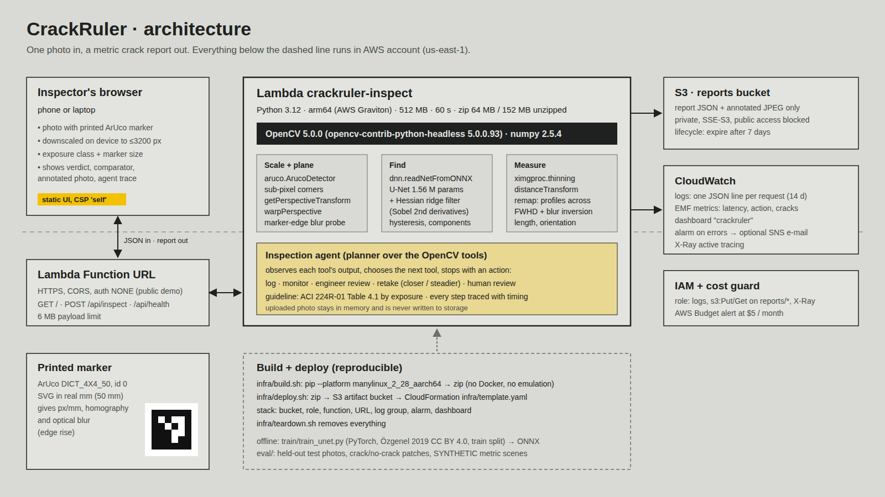

# CrackRuler

Concrete crack widths in millimetres from one phone photo and a printed marker, with a clear next
step. An inspection agent runs OpenCV 5 tools on AWS Lambda (arm64, AWS Graviton). It checks the
frame, fixes scale and camera tilt with an ArUco marker, finds cracks with two independent detectors,
measures width along each crack on the full-resolution image, and compares the result with the
ACI 224R-01 guideline for the chosen exposure. When the evidence is weak, it asks a person.

Built for the OpenCV AI Competition 2026, powered by AWS.

- **Live endpoint:** https://hwytllvqjarqppbcobgqs25lia0hywlx.lambda-url.us-east-1.on.aws/ (arm64 / Graviton; one inspection takes about 20 s on the 512 MB function) · x86 twin for comparison: https://xukarr3uxip3mzgheucpfgxqfm0uzthb.lambda-url.us-east-1.on.aws/
- **Technical report:** [docs/TECHNICAL_REPORT.md](docs/TECHNICAL_REPORT.md)
- **Architecture:** [docs/architecture.png](docs/architecture.png) · agent loop: [docs/agent-loop.png](docs/agent-loop.png)
- **Printable marker:** [app/static/marker-50mm.svg](app/static/marker-50mm.svg)



## Results (from the scripts in `eval/`, numbers committed in `eval/results/`)

| Test | Data | Result |
|---|---|---|
| Pixel segmentation, U-Net in OpenCV 5 DNN | 69 held-out real photos (Özgenel 2019, test split) | F1 0.937 (2 px tolerance), IoU 0.757 |
| Pixel segmentation, classical Hessian ridge (no training) | same 69 photos | F1 0.930, IoU 0.696 |
| Crack / no crack, image level | 1000 + 1000 patches (Özgenel 2019, v2)* | U-Net 99.7 % accuracy, classical 99.3 % |
| Width in mm, end to end | **84 SYNTHETIC scenes** (real concrete backgrounds, synthetic crack and marker) | mean error ≤ 0.045 mm for cracks ≥ 2.4 px across; overestimates below that; 0.1 mm cracks not detected |

\* The patch set was cut from the same family of photos as the segmentation set, so it is not
independent for the U-Net. Details, failure cases and limitations are in the report.

## Run locally

Requirements: Python 3.12, Linux or macOS.

```bash
python3.12 -m venv .venv && . .venv/bin/activate
pip install -r requirements-dev.txt          # pinned: OpenCV 5.0.0.93, numpy 2.5.4
python -m pytest -q tests                    # 10 tests: policy, marker scale, blur probe, deblur, agent, HTTP routes
PORT=8080 python app/local_server.py         # open http://127.0.0.1:8080
```

Command line, one photo:

```bash
python - <<'PY'
import cv2, json
from crackruler.agent import Inspection
rep = Inspection(exposure="humid", marker_mm=50).run(cv2.imread("samples/synthetic-0.35mm.jpg"))
rep.pop("_annotated"); print(json.dumps(rep["decision"], indent=1))
PY
```

## Deploy to AWS

Needs AWS CLI v2 and credentials allowed by [infra/iam-deployer-policy.json](infra/iam-deployer-policy.json)
(least privilege, everything scoped to `crackruler*`; replace `ACCOUNT_ID`).

```bash
AWS_REGION=us-east-1 PY=.venv/bin/python infra/deploy.sh    # build arm64 zip, upload, CloudFormation
# optional: ALARM_EMAIL=you@example.com  -> e-mail on Lambda errors
# optional A/B: ARCH=x86_64 SUFFIX=-x86 STACK=crackruler-x86 infra/deploy.sh
infra/teardown.sh                                             # delete everything
```

`infra/build.sh` downloads the manylinux aarch64 wheels with `pip --platform`, so the arm64 package
builds on any x86 machine without Docker or emulation. The stack (`infra/template.yaml`) creates:
the Lambda function (Python 3.12, arm64, 512 MB by default, `MEMORY=2048 infra/deploy.sh` where the account allows it), its public Function URL, a private S3 bucket for
reports (7-day expiry), a log group (14 days), an error alarm, a CloudWatch dashboard and X-Ray tracing.

Expected cost at demo traffic: inside the AWS free tier (Lambda requests and GB-seconds, S3 storage
for a few MB). An AWS Budget alert at $5/month guards the account.

## Reproduce the evaluation

```bash
# data (CC BY 4.0, Mendeley Data): jwsn7tfbrp (segmentation) and 5y9wdsg2zt (classification),
# extracted to data/seg/{rgb,BW} and data/cls/{Positive,Negative}
python eval/eval_seg.py test        # -> eval/results/seg_test.json
python eval/eval_cls.py 1000        # -> eval/results/cls_sample.json
python eval/synth_width.py 4        # -> eval/results/synth_width.json (SYNTHETIC)
python eval/tune_classical.py 4     # threshold search on the TRAIN split only
python eval/bench.py [https://<function-url>]   # latency per agent tool (Lambda results in eval/results/bench_lambda_*.json)
# training (GPU optional): pip install -r requirements-train.txt && python train/train_unet.py 6000
```

The split is fixed in `eval/split.json` (seed 26: 320 train, 69 validation, 69 test photos).

## Repository map

```
crackruler/  calibrate.py (ArUco scale, rectification, blur probe) · segment.py (U-Net via cv.dnn, Hessian ridge)
             measure.py (centreline, profile widths, blur inversion) · policy.py (ACI 224R-01 table, decision bands)
             agent.py (planner + trace) · render.py (evidence image)
app/         handler.py (Lambda + routing) · local_server.py · static/ (UI, fonts, marker)
models/      crack_unet.onnx (6.2 MB)
eval/        evaluation scripts and committed results
train/       U-Net training and ONNX export
infra/       build.sh · deploy.sh · teardown.sh · template.yaml · iam-deployer-policy.json
samples/     demo photos (labelled SYNTHETIC or REAL)
```

## Data and licences

- Code: Apache-2.0 (see `LICENSE`).
- Training and test photos: *Concrete Crack Segmentation Dataset*, Çağlar Fırat Özgenel, Mendeley
  Data, 2019, doi:10.17632/jwsn7tfbrp.1, CC BY 4.0. Patch test: *Concrete Crack Images for
  Classification*, Özgenel, Mendeley Data, 2019 (v2), doi:10.17632/5y9wdsg2zt.2, CC BY 4.0. Two test photos are
  redistributed in `samples/` (downscaled) under the same licence; synthetic samples use crack-free
  crops of test photos as background.
- Fonts: Saira Condensed, Public Sans, Martian Mono (SIL Open Font License 1.1).
- Crack-width guideline: ACI 224R-01 (Reapproved 2008), Table 4.1, as reproduced with ACI's
  permission in ASPIRE, Winter 2018, p. 42.
