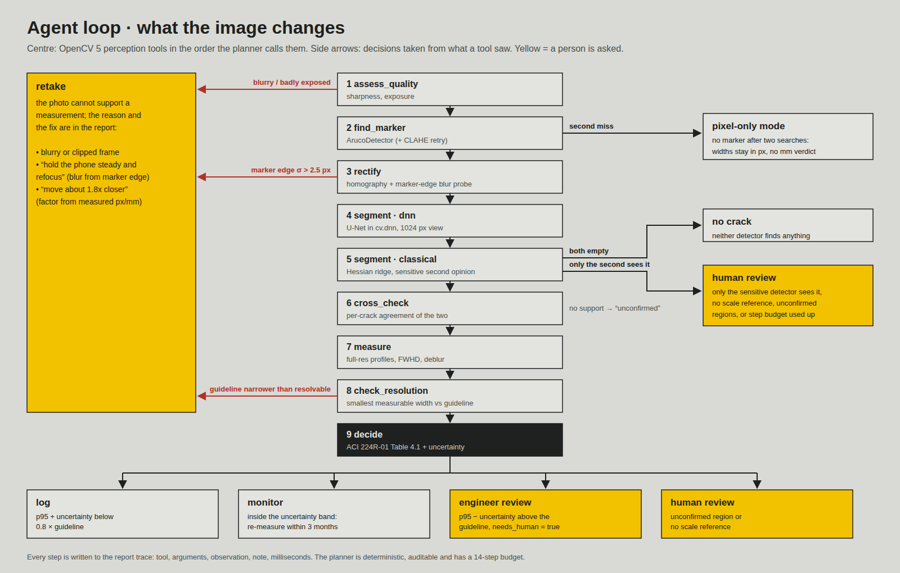
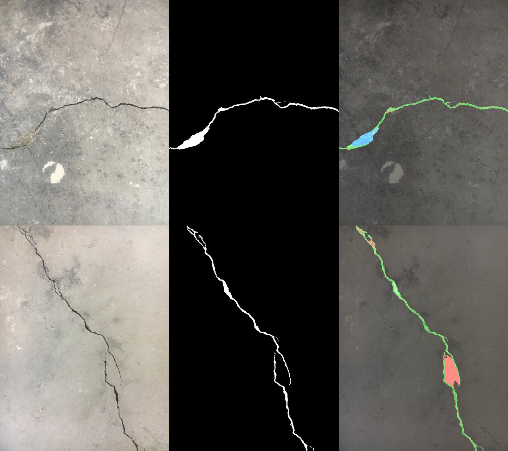

# CrackRuler: technical report

OpenCV AI Competition 2026, powered by AWS · Team: Maksym Stepanenko (INNOVA CONSULT LTD, Ottawa, Canada)
Repository: https://github.com/ctmakc/crackruler · Endpoint: see README

## 1. Problem

Crack width decides what happens to a concrete element. Inspectors of bridges, parking garages,
retaining walls and basements read it today with a plastic comparator card or a crack microscope,
write the value on a form, and repeat the visit months later to see if the crack has grown. The
reading is manual, hard to audit, and depends on who held the card. A phone photo of the same crack
is easy to take, but on its own it has no scale, it is usually tilted, and nobody knows if it was
sharp enough to resolve a 0.2 mm crack.

CrackRuler turns one photo plus a printed marker into a measured, auditable record: where the cracks
are, how wide they are in millimetres along their whole length, how certain that is, and what to do
next under the exposure the element lives in.

## 2. Users

- Building and bridge inspectors, property managers and maintenance crews who already photograph
  defects and need a defensible width with every photo.
- Structural engineers who receive those reports and decide on repair; they get the evidence image,
  the numbers and the agent's reasoning, and are explicitly asked to review the cases that matter.
- Home owners who want to know whether a basement crack needs a professional.

## 3. What the system does

1. The user prints a 50 mm ArUco marker (SVG in real millimetres), puts it flat next to the crack,
   takes a photo and picks the exposure class (dry, humid, de-icing salts, seawater, water-retaining).
2. The browser shrinks the photo to at most 3200 px and posts it to the Lambda Function URL.
3. The inspection agent runs OpenCV 5 tools in a perception-decision-action loop (section 5) and
   returns: an action (log, monitor, engineer review, retake, human review, no crack) with its
   reason; per-crack length, median / 95th-percentile / maximum width; the uncertainty; the
   smallest width this photo can resolve; an annotated evidence image; and the full trace.
4. The UI shows the verdict, the annotated photo, a comparator card (each crack's width against the
   guideline, reference lines drawn at their relative thickness) and the replayed trace.

## 4. Architecture


- **Client:** static HTML/CSS/JS served by the same function, no third-party scripts, CSP
  `default-src 'self'`, self-hosted OFL fonts, light and dark themes, works on phones.
- **Compute:** one AWS Lambda function, Python 3.12, **arm64 (AWS Graviton)**, 512 MB, 60 s timeout.
  512 MB is the per-function cap on our new AWS account. To fit it, the U-Net runs on 512 px windows
  (384 px kept, 64 px of context on each side, windows clipped at the image edge); on the 69 test photos
  this gives the same F1 as a single pass (0.937), and the peak memory on Lambda is 446 MB.
  Package: OpenCV 5.0.0 (`opencv-contrib-python-headless==5.0.0.93`), numpy 2.5.4, the ONNX model
  (6.2 MB) and the app; 64 MB zipped, 152 MB unzipped. It is built without Docker: `pip --platform
  manylinux_2_28_aarch64` fetches the Arm wheels on any machine.
- **Entry:** Lambda Function URL (HTTPS, CORS). Routes: `GET /`, `GET /api/health`,
  `GET /api/samples`, `POST /api/inspect`, `GET /api/report/<id>`.
- **Storage:** private S3 bucket, SSE-S3, public access blocked, objects under `reports/` expire
  after 7 days. Only the report JSON and the annotated JPEG are written. The uploaded photo is
  processed in memory and never stored.
- **Observability:** one structured JSON log line per request in CloudWatch Logs (14-day retention);
  CloudWatch Embedded Metric Format turns the same line into metrics (`LatencyMs`, `Cracks`,
  `Steps`, `Inspections` by `Action`) without extra API calls; a CloudWatch dashboard; an alarm on
  Lambda errors with optional SNS e-mail; X-Ray active tracing.
- **Security:** the execution role can only write logs, `s3:PutObject/GetObject` on `reports/*` of
  its own bucket, and send X-Ray segments. The deployer policy is scoped to `crackruler*`
  resources. Input validation: JPEG/PNG magic bytes, 8 MB and pixel limits (12.6 MP on the deployed
  512 MB function, set by the `MAX_PIXELS` variable), a sample-name allow-list,
  numeric bounds on the marker size, and an exposure allow-list. Unexpected failures return a
  reference id and are logged; they do not leak stack traces.
- **Infrastructure as code:** `infra/template.yaml` (CloudFormation, passes `cfn-lint`), `deploy.sh`,
  `teardown.sh`. The same template deploys an x86_64 twin (`ARCH=x86_64 SUFFIX=-x86`) for the A/B
  latency comparison.
- **Cost guard:** AWS Budget alert at $5/month on the account; at demo traffic the stack stays inside
  the free tier (section 8).

## 5. OpenCV 5 implementation

### 5.1 Scale, plane and blur from the marker (`crackruler/calibrate.py`)

- `cv.aruco.ArucoDetector` with `DICT_4X4_50` and `CORNER_REFINE_SUBPIX`. If the first search finds
  nothing, the agent retries on a CLAHE-equalised grey image.
- `cv.getPerspectiveTransform` maps the marker corners to a square whose side keeps the marker's
  native pixel density (no invented detail); `cv.warpPerspective` rectifies the whole surface so
  the image becomes metric: one px/mm everywhere on the plane. The view is cropped to the imaged area.
- **Blur probe.** The marker's outer black/white edge is a known step. The agent averages 40
  profiles across the middle of each side (`cv.remap`), measures the 10-90 % rise and converts it to
  a Gaussian sigma (rise = 2.563 σ). The value includes defocus, motion, demosaicing, JPEG and our
  own resampling: everything the crack profile also went through.

### 5.2 Finding cracks (`crackruler/segment.py`)

- **Primary: U-Net in the OpenCV 5 DNN engine.** 5 levels (16-192 channels), 1.56 M parameters,
  bilinear up-sampling, trained in PyTorch, exported to ONNX (opset 17, dynamic H × W) and loaded
  with `cv.dnn.readNetFromONNX`. Input via `cv.dnn.blobFromImage` on a 1024 px view. Parity check:
  max absolute logit difference between PyTorch and OpenCV 5 DNN 9.4e-5, identical masks.
- **Second opinion: classical multi-scale Hessian ridge filter.** Illumination is flattened by
  dividing by a σ = 25 Gaussian background; second derivatives come from `cv.Sobel` at σ = 1, 2,
  3.5; the larger Hessian eigenvalue with a Frangi-style anisotropy term gives a dark-line response
  on an absolute scale. It has no training; two hysteresis thresholds were tuned on the train
  split under a ≤ 5 % false-positive constraint on crack-free patches (`eval/tune_classical.py`).
- Both outputs go through hysteresis (`cv.connectedComponents`) and an elongation filter: centreline
  length (from `cv.ximgproc.thinning`) at least 4 × the mean width and at least 40 px. The marker,
  its paper margin and the frame edge are masked out.

### 5.3 Measuring width (`crackruler/measure.py`)

- Centreline: `cv.ximgproc.thinning` (Zhang-Suen) on the coarse mask; local tangent by PCA over
  neighbours; `cv.distanceTransform` sets the search half-length.
- Width: at every third centreline point, a grey-level profile across the crack is sampled at
  0.25 px on the **full-resolution rectified image** (`cv.remap`, all profiles in one call).
  Width = full width at half depth (FWHD) with linear interpolation of both crossings.
- **Blur inversion.** A blurred box of width w has FWHD/σ = F(w/σ); F is tabulated once from the
  erf model and inverted with the σ measured on the marker. When the measured FWHD is within 10 %
  of a point source's (F(0) = 2.355 σ), the width is not resolvable and the upper bound is reported.
- Per crack: length (8-neighbour chain length) in mm, orientation, median, p95 and max width, the
  fraction of samples below resolution, and the raw (un-deblurred) p95 for audit.

### 5.4 Decision (`crackruler/policy.py`)

Guideline widths from ACI 224R-01 (Reapproved 2008), Table 4.1 "Guide to reasonable crack widths,
reinforced concrete under service loads": dry air or protective membrane 0.41 mm; humidity, moist
air, soil 0.30 mm; de-icing chemicals 0.18 mm; seawater and seawater spray, wetting and drying
0.15 mm; water-retaining structures (excluding non-pressure pipes) 0.10 mm. Source used: the table
as reproduced with ACI's permission in ASPIRE, Winter 2018, p. 42.

The widest confirmed crack's p95 width w with a 95 % uncertainty u = 2·sqrt((r·w)² + (0.45 px / px_per_mm)²),
where r is the relative scale uncertainty from corner localisation:

- w + u < 0.8 × guideline → **log**
- w − u > guideline → **engineer review** (needs a person)
- otherwise → **monitor** (re-measure within 3 months)

## 6. The agent (perception → decision → action)



The planner (`crackruler/agent.py`) is a small deterministic policy over eight OpenCV tools. After
each tool it reads the observation and picks the next tool or a terminal action. The visual evidence
changes what happens next in these places:

| Observation | Next step |
|---|---|
| frame blurry or badly exposed (tenengrad, clipping) | stop: **retake** |
| no marker | second search on a CLAHE image; second miss → pixel-only mode, verdict goes to **human review** |
| marker edge blur σ > 2.5 px | stop: **retake** ("hold the phone steady and refocus") |
| primary detector empty | sensitive classical run decides between **no crack** and **human review** |
| a crack the second detector does not support | marked unconfirmed, excluded from the verdict, routes to **human review** if nothing else is found |
| smallest resolvable width > guideline and the crack is near that floor | **retake** "move about N× closer", N from the measured px/mm |
| width vs guideline band | **log / monitor / engineer review** |

Every step is logged in the report trace (tool, arguments, observation, note, ms). A 14-step budget
bounds the loop. Human control: the system never closes a case that needs judgement. Engineer
review, human review and retake all set `needs_human = true`, and ACI's own caveat is shown with
every verdict. Example trace (sample `synthetic-0.60mm-tilted.jpg`):

```
1 assess_quality      frame usable                                            17 ms
2 find_marker         marker found, metric scale available                    33 ms
3 rectify             surface rectified at 8.59 px/mm                        114 ms
4 segment · dnn       dnn found 1 candidate crack region(s)                  822 ms
5 segment · classical classical found 1 candidate crack region(s)            139 ms
6 cross_check         detectors agree                                          9 ms
7 measure             measured 1 crack(s) on the full-resolution view ...     47 ms
8 check_resolution    pixel density resolves the guideline width               0 ms
9 decide              action: engineer_review                                  0 ms
```
(local x86 run limited to 2 threads; the true width of this synthetic crack is 0.60 mm, measured
median 0.61 mm, p95 0.65 mm.)

## 7. Evaluation

All numbers come from scripts in `eval/`; their JSON outputs are committed in `eval/results/`.

### 7.1 Data

*Concrete Crack Segmentation Dataset* (Özgenel 2019, CC BY 4.0): 458 photos (mostly 4032 × 3024)
of cracked concrete with hand-drawn binary masks. Fixed split by photo, seed 26: 320 train /
69 validation / 69 test (`eval/split.json`). The U-Net was trained on train, the checkpoint picked on
validation (F1 0.956), and everything below was measured once on test.

### 7.2 Segmentation on real photos (69 test photos, 1024 px view)

| Detector | Precision | Recall | F1 (2 px tol.) | IoU (strict) | per-photo F1 median / p10 | time / photo |
|---|---|---|---|---|---|---|
| U-Net, OpenCV 5 DNN | 0.917 | 0.959 | **0.937** | **0.757** | 0.963 / 0.866 | 1385 ms* |
| Hessian ridge (classical) | 0.957 | 0.904 | 0.930 | 0.696 | 0.956 / 0.828 | 212 ms* |

\* one x86 desktop CPU capped at 6 cores while other jobs ran, U-Net in 512 px windows as deployed
(479 ms as a single pass on an idle machine); Lambda timings in section 8.

### 7.3 Crack / no crack on patches

1000 positive + 1000 negative 227 × 227 patches (*Concrete Crack Images for Classification*,
Özgenel, CC BY 4.0, seed 26), half-scale. U-Net: 1000/1000 cracks found, 6 false alarms on 1000
crack-free patches (accuracy 99.7 %). Classical: 999/1000, 13 false alarms (99.3 %).
**Caveat:** these patches were cut from the same photo family as the segmentation set, so for the
U-Net this is not an independent test; the classical detector has no training, but its two
thresholds were tuned on a separate subset of the same negatives.

### 7.4 Width in millimetres: SYNTHETIC test (labelled as such everywhere)

We have no field photos with a marker and reference widths, so metric accuracy was measured on
synthetic scenes (`eval/synth.py`, `eval/synth_width.py`): real crack-free concrete crops from the
**test** photos as background, a jagged crack of known constant width rendered with exact
anti-aliased coverage, a 50 mm ArUco marker, then a random camera homography (0-30° tilt),
Gaussian blur σ 0.6-1.2 px, noise and JPEG q88. 7 widths × 3 pixel densities × 4 repeats = 84 scenes.
"Oracle" measures along the true centreline (isolates scale + width method); "agent" is the full
end-to-end run, p50 width of the detected crack.

| true width | px/mm | px across | oracle bias / MAE (mm) | agent detected | agent bias / MAE (mm) |
|---|---|---|---|---|---|
| 0.1 | 5 / 8 / 12 | 0.5 / 0.8 / 1.2 | +0.249 / +0.126 / +0.052 | 0 / 0 / 0 of 4 | – |
| 0.2 | 5 | 1.0 | +0.170 | 3/4 | +0.156 |
| 0.2 | 8 | 1.6 | +0.068 | 4/4 | +0.061 |
| 0.2 | 12 | 2.4 | +0.016 | 4/4 | +0.014 |
| 0.3 | 5 | 1.5 | +0.114 | 4/4 | +0.101 |
| 0.3 | 8 | 2.4 | +0.035 | 4/4 | +0.031 |
| 0.3 | 12 | 3.6 | +0.013 | 4/4 | +0.010 |
| 0.5 | 5 / 8 / 12 | 2.5 / 4 / 6 | +0.040 / +0.031 / +0.019 | 12/12 | 0.027 / 0.020 / 0.013 |
| 0.8 | 5 / 8 / 12 | 4 / 6.4 / 9.6 | +0.057 / +0.027 / +0.018 | 12/12 | 0.045 / 0.018 / 0.014 |
| 1.2 | 5 / 8 / 12 | 6 / 9.6 / 14.4 | +0.032 / +0.030 / +0.023 | 12/12 | 0.028 / 0.023 / 0.015 |
| 2.0 | 5 / 8 / 12 | 10 / 16 / 24 | +0.041 / +0.042 / +0.028 | 12/12 | 0.032 / 0.030 / 0.016 |

Findings: the marker was found in 84/84 scenes; measured blur σ 0.82-1.35 px. Once a crack is at
least ~2.4 px across, mean width error is ≤ 0.045 mm. Below ~2 px the method overestimates; the
error is always positive, which pushes decisions towards more review. The agent's resolution check
detects this regime: all 10 "retake" verdicts are scenes at 5 px/mm, where the 0.30 mm guideline
is not resolvable. The primary detector missed every 0.1 mm crack; in 11 of those 12 scenes the
sensitive second detector saw a candidate and the agent asked for human review; in the twelfth it
reported engineer review because of an unrelated linear feature in the background photo. Such extra
confirmed features appeared in 5 of 84 scenes.

### 7.5 Failure cases on real photos



Worst two U-Net test photos (green = agreement, red = predicted only, blue = mask only).
Top (photo 540, F1 0.78): a spalled, wide section of the crack is labelled crack in the mask; the
U-Net only keeps its dark edges. Bottom (photo 426, F1 0.80): two close parallel branches; the U-Net
fills the concrete between them. Both errors widen or narrow the measured width in that section,
which is one reason the decision uses the 95th percentile and the second detector's support.

### 7.6 Tests

`python -m pytest -q tests`: 10 tests covering the ACI table, decision bands, marker scale (6.00 px/mm
within 0.05), blur probe at σ 0.8 and 1.6, the blur-inversion round trip, end-to-end widths on two
synthetic plates, retake on blur, the second marker search and human review without a marker, and
HTTP routing including path traversal and a non-image upload.

## 8. AWS deployment, latency and cost

Region us-east-1, stack `crackruler`, live endpoint
https://hwytllvqjarqppbcobgqs25lia0hywlx.lambda-url.us-east-1.on.aws/ . Measured on 22 Oct 2026 with
`N=3 python eval/bench.py <url>`:

| Configuration | median server time per inspection | notes |
|---|---|---|
| local x86 desktop, 2 threads | 946 ms | reference, `eval/results/bench_local_x86_2threads.json` |
| AWS Lambda emulator (x86_64 zip, AL2023 image) | 830-1030 ms | same package format as the deployment |
| Lambda arm64 (Graviton), 512 MB | 22 717 ms (U-Net step 20 553 ms) | `eval/results/bench_lambda_arm64.json` |
| Lambda x86_64, 512 MB (A/B twin, same code built for x86) | 10 638 ms (U-Net step 8 260 ms) | `eval/results/bench_lambda_x86.json` |

Both stacks were benchmarked at the same time (3 samples × 3 warm runs each, run in parallel).
At 512 MB a Lambda function gets a fraction of one vCPU, so an inspection takes 10-23 s instead of
about 1 s on a desktop; the UI says so while it runs. The A/B result: the OpenCV tools other than the
DNN run at about the same speed on both (marker search 278 vs 210 ms, rectification 299 vs 340 ms,
ridge detector 701 vs 760 ms, measurement 316 vs 321 ms), while the U-Net in the OpenCV 5 DNN engine
is 2.5 times slower with the stock `opencv-contrib-python-headless` aarch64 wheel. At the Lambda list
prices (arm64 $0.0000133334, x86 $0.0000166667 per GB-s) one inspection costs about $0.00015 on arm64
and $0.00009 on x86. We keep arm64 as the main stack, keep the x86 twin running for comparison
(https://xukarr3uxip3mzgheucpfgxqfm0uzthb.lambda-url.us-east-1.on.aws/ , faster today), and list a
faster Arm inference path (COOL, or an Arm-optimised DNN backend) as next work.

Monthly cost at demo traffic (a few hundred inspections): one inspection is about 0.5 GB × 23 s =
11.4 GB-s on arm64, so the always-free 400 000 GB-s cover roughly 35 000 inspections a month, with 1 M free requests; S3 holds a few MB that
expire after 7 days; CloudWatch logs stay within the free 5 GB. Expected bill: $0.00-$0.10 per month,
covered by AWS credits.

## 9. Limitations

- **No field validation yet.** Metric accuracy is shown on synthetic scenes only; detection and
  segmentation on real photos come from one public dataset (one photographer, similar surfaces).
  The next step is a small set of field photos with comparator-card readings.
- The marker must lie flat in the plane of the crack; curved surfaces, strong lens distortion
  far from the marker and cracks on a different plane break the metric assumption.
- Widths below ~2 px across are optics-limited: they are reported as upper bounds and trigger a
  closer-photo request. 0.1 mm cracks need roughly 15+ px/mm.
- Surface width only: the system sees neither depth nor activity (moving vs dormant cracks).
- Stains, formwork joints, saw cuts and paper edges can look like cracks; the second detector and
  the elongation filter reduce this, they do not remove it.
- The planner is rule-based. It is transparent and testable; it does not learn from feedback.
- The public demo endpoint has no authentication; abuse is limited by input size limits, the
  account's Lambda concurrency limit and the budget alert.

## 10. Responsible use

- ACI 224R-01 Table 4.1 is a design guideline for new construction; ACI notes that a portion of
  cracks will exceed it. CrackRuler uses it to route a finding and never certifies a structure as
  safe. Every wide, uncertain or unresolvable case goes to a person.
- Privacy: the photo is processed in memory and not stored; reports and annotated images expire
  after 7 days; no personal data is collected. Users should avoid photographing people or
  identifying details.
- Honesty in outputs: synthetic samples and results are labelled SYNTHETIC in the UI, the data and
  this report; widths below resolution are shown as upper bounds; unconfirmed detections are shown
  as such.
- Data rights: training and test data are CC BY 4.0 and attributed; fonts are OFL.
- AI assistance: the code was written with the help of an AI coding assistant. The runtime agent is
  the deterministic planner described in section 6; no language model runs in the product.

## 11. Reproducibility checklist

- Pinned runtime: `requirements.txt` (OpenCV 5.0.0.93, numpy 2.5.4); dev: `requirements-dev.txt`;
  training: `requirements-train.txt` (torch 2.5.1, onnx 1.17.0).
- Fixed data split `eval/split.json`, fixed seeds in training (26) and evaluation (26, 2026).
- Build: `infra/build.sh`; deploy: `infra/deploy.sh`; remove: `infra/teardown.sh`;
  template: `infra/template.yaml`; deployer IAM policy: `infra/iam-deployer-policy.json`.
- Tests: `pytest tests`; evaluation: `eval/*.py`; committed outputs: `eval/results/`.
